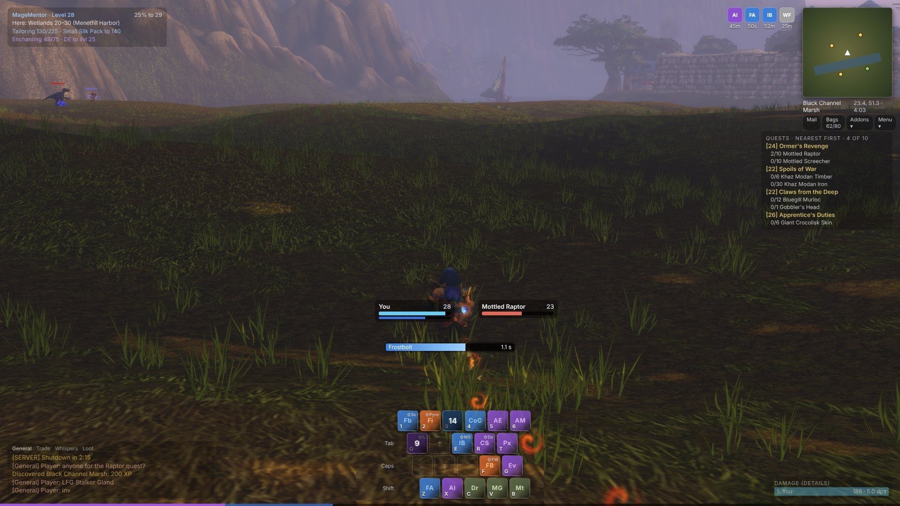
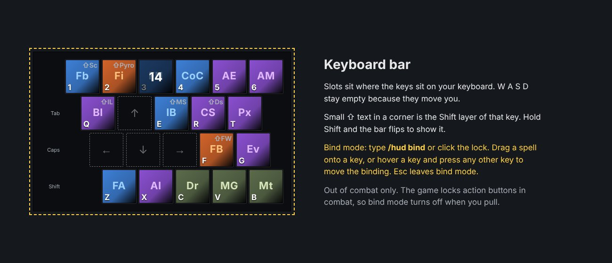

# Glance: design

Glance replaces the parts of the default HUD that take the most space and
help the least. The look is "floating minimal" (option C of three mockups,
picked on 2026-11-09): see-through panels, small bars under the character,
nothing with heavy frame art.

## Pieces and order

| Piece | Where | State |
| --- | --- | --- |
| Keyboard bar | bottom centre | 0.1.0 |
| Player and target bars, cast bar | under the character | 0.1.0 |
| Square minimap, zone, coords, clock, addon drawer | top-right | 0.1.0 |
| Buffs beside the minimap | top-right | later |
| Quest tracker panel (Questie), chat and Details fade out of combat | right, bottom corners | later |
| Bags and game menu as small tabs under the minimap | top-right | later |

Details, Questie, Leatrix Plus and MageMentor stay as they are.

## Keyboard bar

- The slots sit where the keys sit, so the bar is also the key map.
- W A S D stay empty: they move you.
- The Shift layer is shown when Shift is held; a small icon in a key's
  corner shows the other layer.
- A key's spell is the action slot that key fires. The bar reads the
  bindings that exist (Blizzard bars and Bartender4) at the first login,
  and uses override bindings for its keys, so it never changes the saved
  Key Bindings.
- The game locks action buttons in combat, so spells move only out of
  combat.
